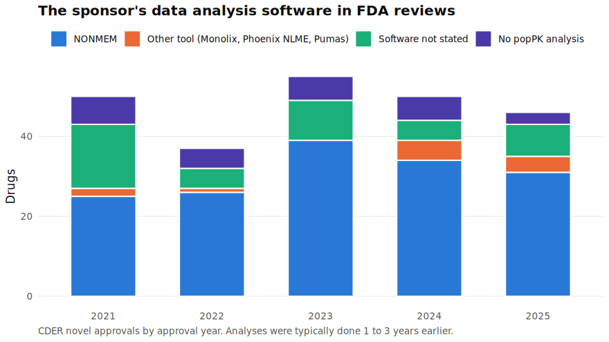
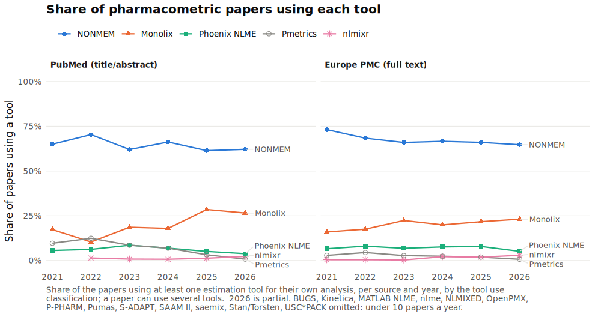
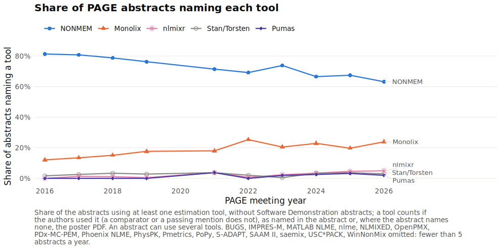
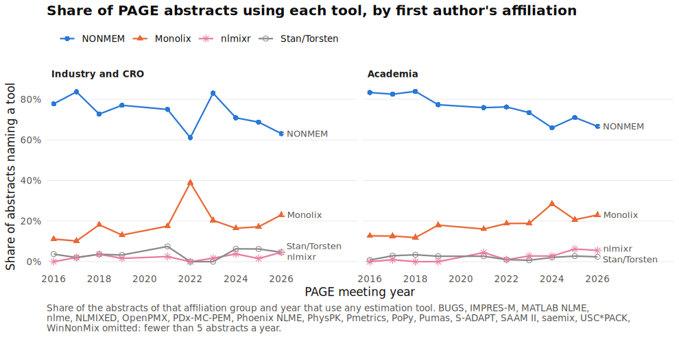

<!-- README.md is generated from README.Rmd by `make readme`. Edit README.Rmd. -->

```{r setup, include = FALSE}
knitr::opts_chunk$set(echo = FALSE, message = FALSE, warning = FALSE)
# The figures quoted from the detailed results, which `make readme` builds first
# (docs/results/estimation-software.Rmd)
numbers <- read.csv("docs/results/readme-numbers.csv", colClasses = "character")
n <- function(name) {
  stopifnot(name %in% numbers$name)
  numbers$value[numbers$name == name]
}
corpusN <- vapply(c(fda = "fda", page = "page", pubmed = "pubmed", epmc = "epmc"), function(s) {
  format(nrow(read.csv(file.path("corpus", s, "items.csv"), colClasses = "character")), big.mark = ",")
}, character(1))
# Tool use: how many decisions the fixed rules made, and how the rules did on papers not used to
# write them (classifications/tool_use)
toolUse <- read.csv("classifications/tool_use/decisions.csv", colClasses = "character")
candidates <- unique(toolUse[c("source", "item_id", "label")])
ruleShare <- sum(toolUse$method == "rule") / nrow(candidates)
rulesCheck <- read.csv("classifications/tool_use/rules_check.csv")
rulesOut <- rulesCheck[rulesCheck$source == "Europe PMC" & rulesCheck$rule == "all", ]
blind <- read.csv("classifications/tool_use/checks.csv")
fmt <- function(x) format(x, big.mark = ",")
pct <- function(x, digits = 0) paste0(formatC(100 * x, format = "f", digits = digits), "%")
results <- "docs/results/estimation-software.md"
```

# PMx Landscape

PMx Landscape measures how pharmacometric modelling is done and used in practice, and
how this changes over time, based on sources openly available on the internet,
for example published FDA reviews, PubMed abstracts and open-access articles.
It is meant to facilitate rational and evidence-based discussions about
pharmacometric practices.

It currently reads three kinds of source side by side: FDA reviews of new drugs, the
published literature (PubMed and Europe PMC) and the abstracts of the PAGE
meeting (Population Approach Group in Europe). The sources are never pooled,
since each counts a different unit, a drug, a paper or an abstract, with its
own lag and bias.

A number of questions (measures) are planned to be answered, for example the
common modelling objectives, the estimation algorithms and the covariate
modelling methods. The first measure, and the one this page shows results
from, is which estimation tool is used, such as NONMEM or Monolix. This measure
was chosen first because it can be counted fairly directly, and it serves as
the worked example of the method. The text below explains the method using the
estimation tool measure as the example.

Most of the current results come from a [development run](docs/glossary.md).
In a development run, the language models are Claude Code subagents: Claude
Sonnet 5.5 reads, and Claude Opus 5.5 checks. The numbers may change when the
production run reads every item again through the Anthropic API, with checks
by people. The FDA results for 2021 to 2025 do not come from a development run.
They come from a record in which every software mention in the reviews was
read and checked.

The code is under the [MIT licence](LICENSE), and the data, results and documents
are under [CC BY 4.0](LICENSE-data.md), which also lists the files that fall under
each.

## How it works

The method has the same three steps for every measure. Code does as much of
the work as it can, and a language model reads only where judgement is needed.

1. **A fixed frame decides what is counted.** Each source has a stated rule for
   which items belong to it, set before anything is counted, such as "every
   novel drug approved by the FDA's Center for Drug Evaluation and Research
   (CDER)". Code then finds what a measure looks for in each item: for the
   estimation tool, the same name patterns find a tool in a review, a paper
   and an abstract. Code makes these steps, so they give the same answer every
   time.
2. **Rules decide the clear cases.** For the estimation tool, each tool a paper
   or abstract names raises the question of whether the authors used it. Fixed rules
   decide `r pct(ruleShare)` of these questions, for example when the text says
   "analysed with NONMEM 7.5". The rules were tested on `r rulesOut$decided`
   Europe PMC questions not used to write them. They differed from an earlier
   language-model reading `r rulesOut$decided - rulesOut$agree` times. Claude
   Opus 5.5 read those sentences and found the rules right each time.
3. **A language model reads the rest, and is checked.** It reads only where
   judgement is needed, such as whether the authors used a tool or only cited
   it. It follows a written codebook for each measure, which is tested on items
   not used to write it and then frozen. In a [blind check](docs/glossary.md), a second
   language model reads a random sample without seeing the first answers. For
   the estimation tool, the two gave the same answer in `r fmt(blind$agree)` of
   `r fmt(blind$compared)` decisions. Claude Opus 5.5 settles every
   disagreement, and the decision is recorded.

The items of each source form the [corpus](docs/glossary.md):

| Source | Unit | Years in the corpus | Items | Years in the results |
|---|---|---|---|---|
| FDA reviews | drug | July 2020 to 2026 | `r corpusN[["fda"]]` | 2021 to 2025 |
| PAGE abstracts | abstract | 1992 to 2026 | `r corpusN[["page"]]` | 2016 to 2026 |
| PubMed | paper | 2016 to 2026 | `r corpusN[["pubmed"]]` | 2021 to 2026 |
| Europe PMC | paper | 2016 to 2026 | `r corpusN[["epmc"]]` | 2021 to 2026 |

The corpus holds more years than the results report so far. Each result says
which years and which of the items it counts.

The project publishes the IDs, links and classifications of the items, never
the text of papers or abstracts. FDA review text is a US government work in
the public domain, so it is published. How each source is framed, searched and
stored is described in the [overview](docs/overview.md) and in a source card
per source (`sources/*/SOURCE.md`).

## Estimation software: what was found

*The literature and PAGE results are from a development run; the numbers may
change at the production run.*

Each source gives each tool's share of the items that use an estimation tool.
The methods, tables and further charts are in the
[detailed results](`r results`).

**FDA reviews of new drugs, 2021 to 2025.** The FDA reviews show what was used
in submissions, in analyses done one to three years before approval.

- NONMEM is the sponsor's tool for `r n("fda_nonmem")` of the
  `r n("fda_identifiable")` drugs whose review shows the tool the sponsor used
  (`r n("fda_nonmem_share")`).
- `r n("fda_other_tools")` account for the other `r n("fda_other")` drugs.
- Of the `r n("fda_total")` approvals, `r n("fda_not_stated")` describe a
  population PK analysis without naming its software.
- Another `r n("fda_no_poppk")` contain no population PK analysis.



**The published literature, 2021 to 2026.** The literature counts the papers
whose authors fitted a population model of their own. The tools are counted in
the open-access full text for Europe PMC, and in the title and abstract for
PubMed.

- NONMEM is used in `r n("ep_used_nonmem")` of the `r fmt(as.integer(n("ep_using")))`
  Europe PMC papers that use an estimation tool.
- Monolix is used in `r n("ep_used_monolix")` of them.
- PubMed gives similar shares: NONMEM `r n("pm_used_nonmem")` and Monolix
  `r n("pm_used_monolix")`, of `r n("pm_using")` papers.



**PAGE meeting abstracts, 2016 to 2026.** PAGE shows work as of the abstract
deadline each March, so it is the most current source. `r n("page_academic")`
of its first authors are academic.

- NONMEM was used in `r n("page_nonmem_2016")` of the 2016 abstracts that used
  an estimation tool.
- By 2026 its share had fallen to `r n("page_nonmem_2026")`.
- Monolix rose from `r n("page_monolix_2016")` to `r n("page_monolix_2026")`
  over the same years.



Data like the above can be analysed and stratified in a number of ways. One is
to stratify it on the type of author that wrote it.

**The results by group of authors.** Every result can be split by a property of
the items, such as the first author's affiliation, which rules classify from
the affiliation text. At PAGE, industry and contract research organisations
(CROs) use the tools in about the same proportions as academia:

- NONMEM is used in `r n("page_sponsor_nonmem")` of the
  `r n("page_sponsor_n")` industry and CRO abstracts that use a tool, and in
  `r n("page_academia_nonmem")` of the `r fmt(as.integer(n("page_academia_n")))`
  academic ones.
- Monolix is used in `r if (n("page_sponsor_monolix") == n("page_academia_monolix")) paste(n("page_sponsor_monolix"), "of the abstracts in each group") else paste(n("page_sponsor_monolix"), "and", n("page_academia_monolix"), "of them")`.



## First analyses built on the software measure

*These analyses are from a development run; the numbers may change at the
production run.*

Each analysis is described in full in the detailed results.

- **[Analysis types by tool](`r results`#analysis-types-by-tool):** in FDA
  submissions, the sponsor's estimation tool is used for population
  pharmacokinetics (PK) alone for `r n("fda_pk_only")` of the
  `r n("fda_types_n")` drugs whose review itself names that tool. At PAGE,
  `r n("page_pk_only")` of the `r n("page_types_n")` abstracts that used a tool
  are PK only. NONMEM carries most of the plain PK work there, and the other
  tools lean towards more complex analyses.
- **[Model and data size by tool](`r results`#model-and-data-size-by-tool):**
  Monolix models have more random effects than NONMEM models,
  `r n("ms_iiv_monolix")` against `r n("ms_iiv_nonmem")` terms on average.
  NONMEM models have more covariate effects only before adjustment for analysis
  type, data size and year.
- **[The lag of FDA submissions behind PAGE](`r results`#1-the-lag-of-fda-submissions-behind-page):**
  NONMEM's share of FDA approvals fits the PAGE trend of industry and CRO
  abstracts best at a lag of `r n("lag_best")` years. That is the longest lag
  the PAGE data allow, so the lag is a lower bound, not an estimate.
- **[From methodology to applied work](`r results`#2-from-methodology-to-applied-work):**
  Monolix started in PAGE's methodology sessions, the sessions on methods, and
  moved into applied work. In `r n("monolix_first_years")`,
  `r n("monolix_first_methods")` of its abstracts were in methodology sessions.
  In 2023 to 2026, `r n("monolix_last_methods")` were.
- **[AI and machine learning](`r results`#ai-and-machine-learning):** machine
  learning was first used at PAGE in `r n("ml_first_page")`, in a neural
  network. In 2024 to 2026, `r n("page_ml_recent")` of PAGE abstracts mention
  it, against `r n("page_ml_early")` in 2016 to 2019.

## What comes next

- **More measures:** the modelling objective, the estimation algorithm and the
  covariate modelling method, then the analysis method, methodology against
  applied work, and links between items across sources. More may be added over
  time.
- **The production run:** every item read again through the Anthropic API,
  with checks by people, for a numbered release.
- **More sources:** a new source, such as another meeting's abstracts, joins as
  a folder of its own with a source card, without changing the others.

## Find out more

- [Detailed results](`r results`): every table, chart and method of the
  software measure.
- [Overview](docs/overview.md): the sources, what is published and how items
  are classified, on one page.
- Source cards (`sources/*/SOURCE.md`): the frame, period, terms of use and
  known biases of each source.
- Classification cards (`classifications/*/`): the codebook, decisions and
  checks of each measure.
- [Glossary](docs/glossary.md): the terms used in a specific sense.

## Reproducing the results

The [guides](docs/README.md) describe how to set up, rerun, check and extend
each part. Three commands, run from the repository root, check and rebuild the
results:

```
make fda-verify   # FDA search in R; must report 0 unexplained mentions
make test         # all tests, including the exact reproduction of the FDA results
make readme       # rebuild this page and the detailed results from the committed results
```

## Repository layout

The repository has one folder for each part of the work:

```
sources/<name>/   one folder per source: source card, retrieval code, inputs, results
corpus/           one item table and one section table per source: IDs, URLs, sizes, hashes
classifications/  one folder per question asked of the items: codebook, decisions, card
database/         the tags of every classification, in one database
analysis/         analyses built on the tags (analysis types, model size, AI and machine learning)
taxonomy/         tool families, search patterns, affiliation rules, tool discovery
pmxlandscape/     R package: search, corpus, classification, summaries, charts
docs/             how to use and extend the repository; docs/results/ holds the detailed results
figures/          the charts, built by make readme
```

## Licence and citation

The code is under the [MIT licence](LICENSE). The data, results, charts and
documents are under [CC BY 4.0](LICENSE-data.md): anyone may reuse them, also
commercially, as long as PMx Landscape is credited. The copyright holder of both
is Pharmetheus AB. Neither licence covers the texts of the sources or the names
of the software tools; [LICENSE-data.md](LICENSE-data.md) lists the terms that
apply to them. PubMed data are courtesy of the U.S. National Library of
Medicine.

[PRIVACY.md](PRIVACY.md) describes how the data about authors are handled, and
how an author can object.

To cite the project, use the details in [CITATION.cff](CITATION.cff): Niclas
Jonsson, *PMx Landscape*, version 0.3.0.
