<!-- estimation-software.md is generated from estimation-software.Rmd by `make readme`, run from the
repository root. Edit the .Rmd. -->

# Estimation software: detailed results

PMx Landscape first measures which estimation software is used for population pharmacokinetic
and related model-based analyses. This document gives the detailed results of that measure, source
by source, with their methods, tables and charts, followed by the first analyses built on the
measure and a first look at machine learning and AI. The project and its method are summarised in
the [README](../../README.md), and terms used in a specific sense are defined in the
[glossary](../glossary.md).

## FDA reviews of new drugs, 2021 to 2025

**In short.**

- NONMEM is the sponsor's tool for 93% of the
  167 drugs with an identifiable tool.
- The other drugs with an identifiable tool use Monolix, Phoenix NLME and Pumas.
  No other estimation tool searched for is the sponsor's tool for any drug.
- No document names the software for 18%
  of the 238 approvals.
- In 2021 the software is still not named for 32%
  of the approvals. In later years the share is 10%
  to 18%.
- The sponsor's own papers give a likely tool for 7 of the
  44 drugs without a named tool. Adding these likely tools
  leaves NONMEM's share at 93%.

**Methods.** The drugs counted are the novel drug approvals of 2021 to 2025 by
the FDA's Center for Drug Evaluation and Research (CDER). For each drug, three
kinds of review were searched for software names: the integrated, the
multi-discipline and the clinical pharmacology review. Pages that hold only an
image were read by optical character recognition (OCR). Every mention was then
read to decide whose software it was: the sponsor's, the FDA reviewer's, or
neither (for example a citation). The reviews call the sponsor the applicant.
A [tool family](../../docs/glossary.md), meaning a tool with all its versions and
spellings, counts once per drug.

Sometimes the FDA reviewer ran the sponsor's model or dataset in a tool, and
the review names no other tool for the sponsor. That tool then counts as the
sponsor's, as indirect evidence
([revisions](../../sources/fda/results/record_revisions.csv)).

The evidence for the sponsor's software has these grades:

- **Stated:** a document names the sponsor's software.
- **Indirect:** the software is not stated as such, but the review shows it
  was used, for example through a NONMEM control stream in the submitted file
  list or an entry in the abbreviation list. Indirect evidence counts towards
  the shares.
- **Template-only case:** an indirect case whose only evidence is the FDA
  template sentence "The final NONMEM data file for analysis contained ...".
  Reviews have kept this sentence unchanged when the sponsor used another tool,
  so Table 1 gives the shares both with and without these cases.
- **Software not stated:** the review describes a population PK analysis, but
  no document searched names its software.
- **Likely tool:** for a drug whose software is not stated, the single tool
  named in the sponsor's own papers on the drug. It is likely, not verified,
  so the FDA record keeps these drugs as not stated.

The reviews name no software for 60 drugs that have a
population PK analysis. For these drugs, two more kinds of document were
searched, and every hit was read: the submission's other review documents, and
the assessment report of the European Medicines Agency (EMA) for the same
active substance
([other documents card](../../sources/fda/other_reviews/README.md)). A tool named
there for the sponsor's population PK analysis counts as stated when the EU
procedure was close in time to the FDA's. It counts as indirect when it comes
from an earlier or later submission, or when the document names the tool only
for a related analysis.

For the drugs whose review names no software, Europe PMC was also searched for
the sponsor's own papers on the drug, by brand name, ingredient or development
code. For a drug still without a named tool, a single tool named in these
papers counts as the likely tool if the papers were published from 4 years
before to 2 years after approval. On the drugs whose review does name the
tool, this rule agreed with the review for
47 of 48.
Details are in the [source card](../../sources/fda/SOURCE.md) and the
[cross-check card](../../sources/fda/crosscheck/README.md).

The chart shows each year's approvals by the sponsor's data analysis software.

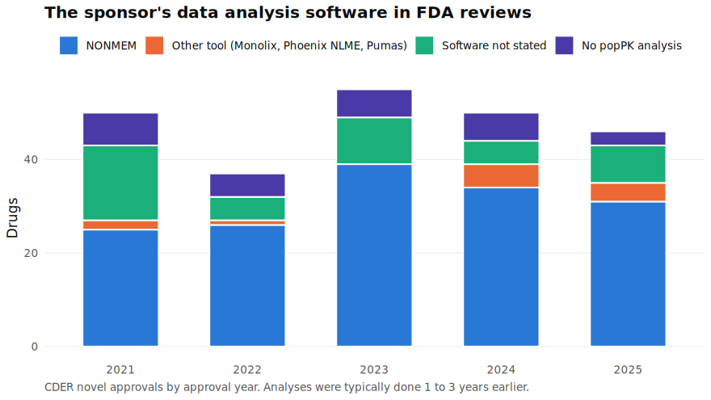

Of the 238 approvals, 167 name the sponsor's
software, directly or indirectly. Another
44 describe a population PK
analysis without naming the software, and
27 contain no population PK analysis.

Table 1 gives the drugs per tool, and each tool's share of the
167 drugs with an identifiable tool. It also gives the
shares without the 9 template-only cases, and with the likely
tools added (174 drugs).

Table 1. The sponsor's data analysis software

|Sponsor's data analysis software | Drugs| Share of the drugs with an identifiable tool| Share excluding template-only cases| Share with the likely tools from the literature added|
|:--------------------------------|-----:|--------------------------------------------:|-----------------------------------:|-----------------------------------------------------:|
|NONMEM                           |   155|                                          93%|                                 92%|                                                   93%|
|Monolix                          |     8|                                           5%|                                  5%|                                                    5%|
|Phoenix NLME                     |     3|                                           2%|                                  2%|                                                    2%|
|Pumas                            |     1|                                           1%|                                  1%|                                                    1%|

Of the 60 drugs whose review names no software, the
submission's other documents name it for 16. The other
44 are the drugs without a named tool. Table 2 gives the
evidence found in the sponsor's papers for each of them. Only the first row,
a sponsor paper near submission, counts as a likely tool.

Table 2. Drugs without a named tool: evidence in the sponsor's papers

|Evidence in the literature        | Drugs|Tool named          |
|:---------------------------------|-----:|:-------------------|
|sponsor paper near submission     |     7|Monolix 1, NONMEM 6 |
|sponsor paper, other years        |     2|NONMEM 2            |
|sponsor papers name several tools |     1|                    |
|other authors only                |     5|                    |
|none                              |    29|                    |

**Conclusions**

- Without the template-only cases, NONMEM's share of the drugs with an
  identifiable tool is 92%.
- The estimation tools searched for that are never the sponsor's tool are
  nlmixr, Stan/Torsten, saemix, FERX, S-ADAPT/ADAPT, Pmetrics, NLMIXED and WinBUGS/NONMEM-BUGS.
- The submission's other documents name the tool for 16 of the
  60 drugs whose review does not. Of these,
  9 are stated and
  7 indirect.
- The tool these other documents name is always
  NONMEM. All but
  1 of them are EMA
  assessment reports.
- The likely tools from the sponsor's papers are
  6 NONMEM and 1 Monolix.

**Discussion.** The FDA reviews are the only source here that records what
was used in submissions rather than what was mentioned. They trail current
practice, since the analyses are done 1 to 3 years before approval. The main
gap is the drugs for which no document names the software. The cross-check of
the sponsor's papers reaches only 7 of the 44
drugs. EMA assessment reports agree with the FDA
reviews where both name the tool. They name it for only about a third of the
drugs, so they fill part of the gap rather than make a series of their own.

**By twelve-month period.** Two further charts add a view of the approvals by
July-to-June period, next to the 2021 to 2025 results by calendar year. They do
not replace those results. The periods run from July to June, so that the
latest period ends with the last half-year that is at least three months past.
They cover July 2020 to June 2026. The charts therefore include approvals that
the 2021 to 2025 results do not have: those of July to December 2020 and of
January to June 2026.

*Development run results for the approvals of July to December 2020 and January
to June 2026: read by Claude Code subagents; the numbers may change at the
production run.* For these approvals, the sponsor's software comes from a
[development run](../../docs/glossary.md) of the
[FDA tool use classification](../../classifications/fda_use/card.md), read by
Claude Sonnet 5.5 subagents. When a review names no tool, a
[reading of its own](../../classifications/fda_poppk/card.md) decides between
"software not stated" and "no population PK analysis". These drugs were not
searched in other documents, as the 2021 to 2025 drugs were. The 2021 to 2025
approvals keep their values from the FDA record. "Review not posted" marks one
approval of December 2020 (gallium Ga 68 PSMA-11) for which no review document
was found on Drugs@FDA, the FDA's database of approved drugs. The charts show
the periods as numbers of drugs and as shares.

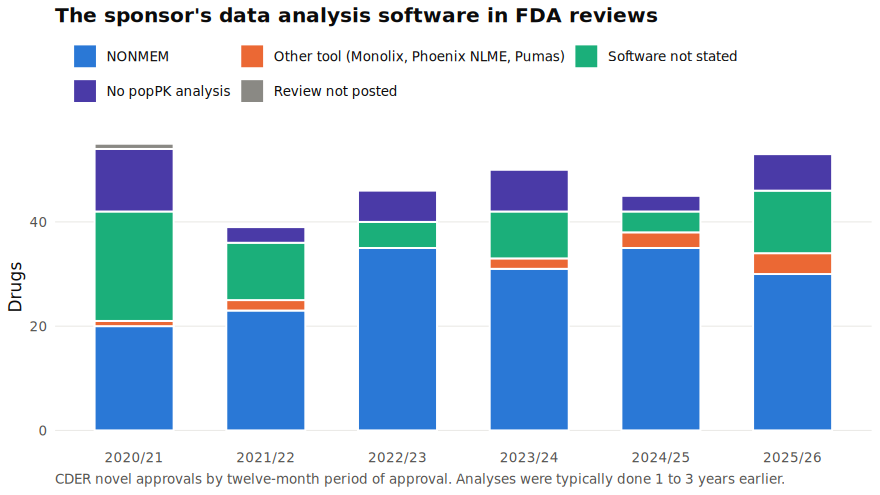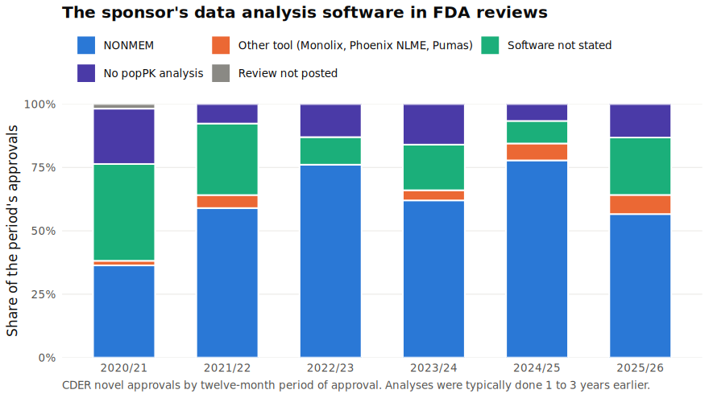
## Published literature, 2021 to 2026

*Development run results: read by Claude Code subagents; the numbers may change at the production run.*

**In short.**

- NONMEM is named in 67% of the PubMed papers that
  name an estimation tool, and in 70% of the Europe PMC
  ones. Monolix is named in 19% and
  21% of them.
- Phoenix NLME follows with 5% (PubMed) and
  7% (Europe PMC). Every other tool is at
  7% or less.
- Counting only the tools the authors used, NONMEM is used in
  65% (PubMed) and 67% (Europe
  PMC) of the papers that use an estimation tool. Monolix is used in
  20% (PubMed) and 20% (Europe PMC).
- In Europe PMC, 94% of the papers
  with a model fit of their own name an estimation tool.
- In PubMed, papers with an industry or contract research organisation (CRO)
  first author name NONMEM more often than academic papers:
  89% against
  65% of the papers naming a tool. The
  industry and CRO group is small, with 76 papers.

**Methods.** The method has three steps: find the papers, keep those with a
model fit of their own, and count the tools in those. The papers are counted by
publication year, and 2026 is partial. Preprints are left out.

*Finding the papers.* A paper is found by one of two routes, or by both:

- **Term route:** the paper uses the field's names for the method. These are
  "population pharmacokinetic(s)", pharmacometric* (any word that starts so)
  and "(non-)linear mixed effects", which make up the
  [core set](../../docs/glossary.md), retrieved on 2026-09-28. They are also the
  short forms such as "population PK", "population pharmacodynamic" and NLME
  (nonlinear mixed effects), which make up the [extension](../../docs/glossary.md).
- **Tool route:** the paper names an [estimation tool](../../docs/glossary.md) made
  for pharmacometric work (NONMEM, Monolix, Phoenix NLME, nlmixr, Pumas,
  Pmetrics, saemix or S-ADAPT), whatever it calls its method.

PubMed is searched in the title and abstract. Europe PMC is searched in the
title, abstract and keywords for the terms. For the tools, it is searched in
the methods of open-access full text.

*Keeping the papers with a model fit of their own.* Every paper found was read
for whether its authors fitted a population model of their own, in pharmacology
(the [relevance classification](../../classifications/lit_relevance/card.md)). Claude
Sonnet 5.5 read the papers. Only papers read as having a model fit of their own
are counted:

- Of the 5900 PubMed papers
  found, 3734
  have a model fit of their own.
- Of the 4486 Europe PMC papers found with full text,
  2935
  have one.

The papers left out use a published model, are reviews or commentaries, use
mixed-effects models outside pharmacology, or could not be decided. The papers
with a model fit of their own are the row "Papers with a model fit of their
own" in Tables 3 and 4. A blind second reading of a random sample by Claude
Opus 5.5, which did not see the first answers, gave the same value for
2362 of 2470 papers.

*Counting the tools.* The tools are found in each counted paper's own text,
downloaded once (the [corpus](../../corpus/README.md)). The name patterns are the
same as for PAGE and FDA. In PubMed the text is the title, abstract and
keywords. In Europe PMC it is the full text of the open-access articles,
without the reference list and the back matter. Each tool is counted in two
ways:

- **Naming:** a paper counts for every estimation tool it names.
- **Using:** a paper counts only for the tools its authors used for their own
  analysis, by the [tool use classification](../../classifications/tool_use/card.md).
  Rules decide the clear cases and Claude Sonnet 5.5 reads the rest. A blind
  second reading by Claude Opus 5.5 gave the same value for
  967 of 995 pairs of a paper and a tool.

The two counts give two kinds of share, with different denominators. A naming
share is out of the papers that name at least one estimation tool. A using
share is out of the papers that use at least one.

The first author's affiliation is taken from the PubMed record. Rules classify
it as industry, CRO, academia, regulator or vendor. The IDs behind every count
are stored. Details are in the [source card](../../sources/literature/SOURCE.md).

**Naming shares.** The chart of naming shares gives each tool's share of the
papers that name at least one estimation tool, per source and year. In PubMed
these are 27% of the papers with a
model fit of their own, since software is rarely named in the abstract. In
Europe PMC they are 94%.

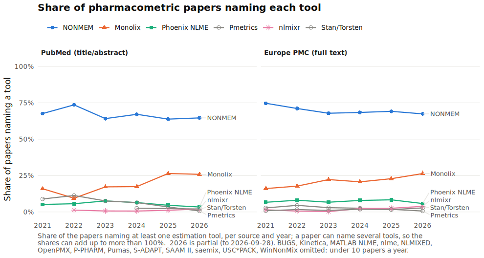

Tables 3 and 4 give the naming counts per year, including the tools too rare
to see in the chart.

Table 3. PubMed (title/abstract): papers per tool and year

|                                     |      2021|      2022|      2023|      2024|      2025|      2026|
|:------------------------------------|---------:|---------:|---------:|---------:|---------:|---------:|
|Papers with a model fit of their own |       778|       604|       525|       628|       667|       532|
|Naming an estimation tool            | 213 (27%)| 159 (26%)| 145 (28%)| 155 (25%)| 174 (26%)| 147 (28%)|
|NONMEM                               | 144 (68%)| 117 (74%)|  93 (64%)| 104 (67%)| 111 (64%)|  95 (65%)|
|Monolix                              |  34 (16%)|   15 (9%)|  25 (17%)|  27 (17%)|  46 (26%)|  38 (26%)|
|Pmetrics                             |   19 (9%)|  18 (11%)|   11 (8%)|   10 (6%)|    6 (3%)|    1 (1%)|
|Phoenix NLME                         |   11 (5%)|    9 (6%)|   11 (8%)|   10 (6%)|    8 (5%)|    5 (3%)|
|nlmixr                               |         0|    2 (1%)|    1 (1%)|    1 (1%)|    2 (1%)|    3 (2%)|
|S-ADAPT                              |   1 (<1%)|         0|    3 (2%)|    2 (1%)|    1 (1%)|    1 (1%)|
|Pumas                                |   1 (<1%)|    1 (1%)|    1 (1%)|         0|    1 (1%)|    3 (2%)|
|Stan/Torsten                         |         0|         0|         0|    4 (3%)|         0|    3 (2%)|
|saemix                               |    2 (1%)|         0|         0|    2 (1%)|         0|         0|
|Kinetica                             |   1 (<1%)|         0|         0|         0|         0|         0|
|OpenPMX                              |         0|         0|         0|         0|         0|    1 (1%)|
|P-PHARM                              |   1 (<1%)|         0|         0|         0|         0|         0|

Table 4. Europe PMC (full text): papers per tool and year

|                                     |      2021|      2022|      2023|      2024|      2025|      2026|
|:------------------------------------|---------:|---------:|---------:|---------:|---------:|---------:|
|Papers with a model fit of their own |       492|       515|       399|       448|       585|       496|
|Naming an estimation tool            | 466 (95%)| 484 (94%)| 373 (93%)| 430 (96%)| 551 (94%)| 466 (94%)|
|NONMEM                               | 348 (75%)| 344 (71%)| 253 (68%)| 294 (68%)| 381 (69%)| 314 (67%)|
|Monolix                              |  75 (16%)|  86 (18%)|  83 (22%)|  89 (21%)| 126 (23%)| 123 (26%)|
|Phoenix NLME                         |   31 (7%)|   39 (8%)|   25 (7%)|   34 (8%)|   46 (8%)|   27 (6%)|
|Pmetrics                             |   13 (3%)|   22 (5%)|   11 (3%)|   11 (3%)|   10 (2%)|    3 (1%)|
|nlmixr                               |    7 (2%)|    3 (1%)|   1 (<1%)|   10 (2%)|   14 (3%)|   18 (4%)|
|Stan/Torsten                         |    4 (1%)|    8 (2%)|    4 (1%)|    8 (2%)|    9 (2%)|   13 (3%)|
|Pumas                                |   1 (<1%)|    4 (1%)|    3 (1%)|    3 (1%)|    6 (1%)|    7 (2%)|
|S-ADAPT                              |    3 (1%)|    5 (1%)|    3 (1%)|    3 (1%)|   1 (<1%)|    7 (2%)|
|nlme                                 |    6 (1%)|    4 (1%)|    2 (1%)|    4 (1%)|   2 (<1%)|    3 (1%)|
|BUGS                                 |   2 (<1%)|   2 (<1%)|   1 (<1%)|   2 (<1%)|   1 (<1%)|         0|
|saemix                               |    3 (1%)|   1 (<1%)|   1 (<1%)|         0|   1 (<1%)|   2 (<1%)|
|MATLAB NLME                          |   1 (<1%)|         0|   1 (<1%)|   1 (<1%)|   2 (<1%)|         0|
|Kinetica                             |    3 (1%)|         0|   1 (<1%)|         0|         0|         0|
|USC*PACK                             |   1 (<1%)|   1 (<1%)|   1 (<1%)|         0|   1 (<1%)|         0|
|NLMIXED                              |   1 (<1%)|   1 (<1%)|         0|         0|   1 (<1%)|         0|
|P-PHARM                              |   1 (<1%)|         0|         0|   1 (<1%)|         0|         0|
|SAAM II                              |   1 (<1%)|         0|         0|         0|         0|   1 (<1%)|
|OpenPMX                              |         0|         0|         0|         0|         0|   1 (<1%)|
|WinNonMix                            |         0|         0|         0|   1 (<1%)|         0|         0|

**Using shares.** The chart of using shares gives each tool's share of the
papers that use at least one estimation tool for their own analysis. These are
24% of the PubMed papers with a model
fit of their own, and 92% of the
Europe PMC ones.

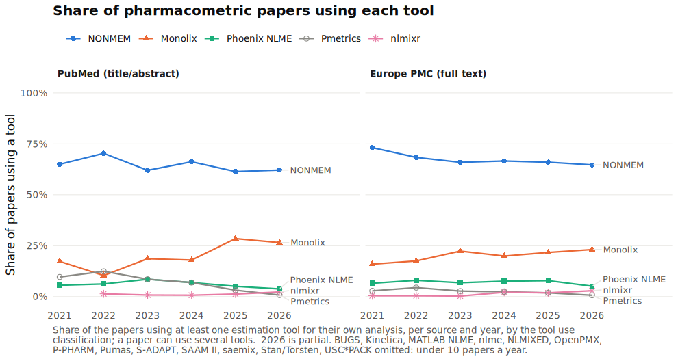

Table 4b gives, per tool, the number of papers naming it and the number using
it.

Table 4b. Papers naming and using each tool, 2021 to 2026

|Source                  |Tool         | Naming| Using|
|:-----------------------|:------------|------:|-----:|
|Europe PMC (full text)  |NONMEM       |   1934|  1826|
|Europe PMC (full text)  |Monolix      |    582|   542|
|Europe PMC (full text)  |Phoenix NLME |    202|   190|
|Europe PMC (full text)  |Pmetrics     |     70|    67|
|Europe PMC (full text)  |nlmixr       |     53|    37|
|Europe PMC (full text)  |Stan/Torsten |     46|    26|
|Europe PMC (full text)  |Pumas        |     24|    21|
|Europe PMC (full text)  |S-ADAPT      |     22|    17|
|Europe PMC (full text)  |nlme         |     21|     9|
|Europe PMC (full text)  |BUGS         |      8|     2|
|Europe PMC (full text)  |saemix       |      8|     5|
|Europe PMC (full text)  |MATLAB NLME  |      5|     4|
|Europe PMC (full text)  |Kinetica     |      4|     3|
|Europe PMC (full text)  |USC*PACK     |      4|     1|
|Europe PMC (full text)  |NLMIXED      |      3|     3|
|Europe PMC (full text)  |P-PHARM      |      2|     1|
|Europe PMC (full text)  |SAAM II      |      2|     1|
|Europe PMC (full text)  |OpenPMX      |      1|     1|
|Europe PMC (full text)  |WinNonMix    |      1|     0|
|PubMed (title/abstract) |NONMEM       |    664|   585|
|PubMed (title/abstract) |Monolix      |    185|   179|
|PubMed (title/abstract) |Pmetrics     |     65|    64|
|PubMed (title/abstract) |Phoenix NLME |     54|    54|
|PubMed (title/abstract) |nlmixr       |      9|     9|
|PubMed (title/abstract) |S-ADAPT      |      8|     4|
|PubMed (title/abstract) |Pumas        |      7|     7|
|PubMed (title/abstract) |Stan/Torsten |      7|     6|
|PubMed (title/abstract) |saemix       |      4|     4|
|PubMed (title/abstract) |Kinetica     |      1|     1|
|PubMed (title/abstract) |OpenPMX      |      1|     1|
|PubMed (title/abstract) |P-PHARM      |      1|     1|

**Naming shares by affiliation.** The chart of PubMed naming shares by
affiliation splits the PubMed papers that name a tool by the first author's
affiliation: industry and CRO against academia. Of the
993 PubMed
papers that name a tool, 76 have an industry or CRO first
author. 750 have an academic one. The others have a first
author from a regulator or a vendor, or no classified affiliation.

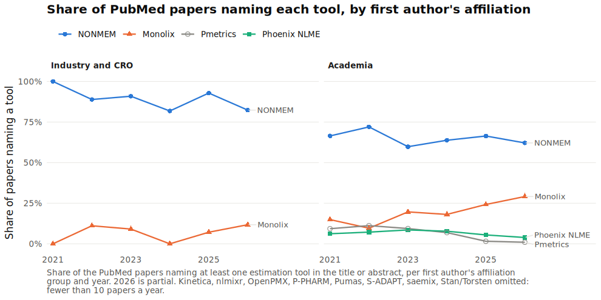

Table 5 gives the papers per affiliation group and year.

Table 5. PubMed papers by first author's affiliation

|                                | 2021| 2022| 2023| 2024| 2025| 2026|
|:-------------------------------|----:|----:|----:|----:|----:|----:|
|Industry and CRO: papers        |  162|  111|   95|  126|  125|   89|
|Industry and CRO: naming a tool |   14|    9|   11|   11|   14|   17|
|Academia: papers                |  535|  427|  379|  429|  463|  356|
|Academia: naming a tool         |  161|  125|  117|  116|  128|  103|

**Discussion.** The naming series counts mentions. A paper that names a tool
may have used it, compared it or only discussed it. In Europe PMC a tool named
anywhere in the article text counts, the introduction included.

The using series removes comparators and passing mentions. In PubMed it can
only see what the title and abstract say, so a tool named only among the
keywords shows no use.

Every paper was read for a model fit of its own. Reviews, and papers that only
cite a tool, therefore leave both the naming and the using counts.

The tool route was added after a check of the term route alone. That check
showed that the term route held a smaller part of the papers using some tools
(Monolix, Pumas) than of the papers using NONMEM. Papers that name no tool and
do not use the field's names are still missed.

The readers also found a few papers that do name a tool, in a form the search
misses. Examples are NONMEM's expanded name without the word "NONMEM", or a name
that Europe PMC's index does not match. These papers count as naming no tool.

PubMed misses most software, since software is usually named only in the
methods. Both databases keep indexing, so a re-run gives other numbers. The
stored IDs make these numbers reproducible.

## PAGE meeting abstracts, 2016 to 2026

*Development run results: read by Claude Code subagents; the numbers may change at the production run.*

**In short.**

- NONMEM is used in 73% of the 1904 abstracts
  that use an estimation tool. NONMEM was used in 81% of those
  from 2016 and 63% of those from 2026.
- Monolix is second, with 19%. Monolix was used in
  12% of those from 2016 and
  24% of those from 2026.
- nlmixr and Stan/Torsten follow, with 2% and
  3%. Every other tool is at
  1% or less.
- Industry and CRO abstracts and academic abstracts name the tools in similar
  proportions. NONMEM is in 73% of the
  industry and CRO abstracts and 75% of
  the academic ones. For Monolix the two shares are
  18% and
  18%.

**Methods.** PAGE is the annual meeting of the Population Approach Group in
Europe.

- **Abstracts:** every abstract of the PAGE meetings 2016 to
  2026 was retrieved from page-meeting.org. There was no meeting in
  2020.
- **Finding the tools:** tools are searched for in the abstract, with the
  authors and references left out. Where the abstract names no tool, they are
  searched for in the poster or slides PDF, and every hit there was read by
  hand.
- **Use:** the [tool use classification](../../classifications/tool_use/card.md)
  decides what the authors did with each tool the abstract names, as for the
  literature. Rules decide first. Claude Sonnet 5.5 subagents read the rest
  (the [reading](../../docs/glossary.md)), and Claude Opus 5.5 subagents read a
  sample again without seeing those answers (the
  [blind check](../../docs/glossary.md)).
- **What counts:** only the [estimation tools](../../docs/glossary.md) the authors
  used. A tool named as a comparator or in passing does not count.
- **Against the earlier reading:** the earlier reading of the same abstracts
  gives the same value for 97.6% of the tools. That is
  3284
  of the 3365 pairs of abstract and tool that both readings
  decided.
- **Left out:** the 62 abstracts of the Software Demonstration session,
  since they are about a tool rather than its use.
- **Affiliation:** the first author's [affiliation type](../../docs/glossary.md)
  (academia, industry, contract research organisation (CRO), software vendor
  or regulator) is decided by rules from the affiliation text, as for the
  literature.

Details are in the [source card](../../sources/page/SOURCE.md).

Of the 3726 abstracts, 1963 name an estimation tool. Of the same
3726, 1904 (51%) used one. The chart of tool shares
per meeting year shows each tool's share of those 1904 abstracts.

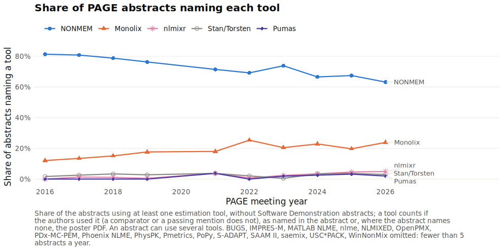

Table 6 gives the using counts per tool and year.

Table 6. PAGE abstracts using each tool, per year

|                         |      2016|      2017|      2018|      2019|      2021|      2022|      2023|      2024|      2025|      2026|
|:------------------------|---------:|---------:|---------:|---------:|---------:|---------:|---------:|---------:|---------:|---------:|
|Abstracts                |       326|       299|       336|       382|       285|       276|       414|       470|       478|       460|
|Using an estimation tool | 182 (56%)| 156 (52%)| 179 (53%)| 215 (56%)| 161 (56%)| 146 (53%)| 210 (51%)| 236 (50%)| 218 (46%)| 201 (44%)|
|NONMEM                   | 148 (81%)| 126 (81%)| 141 (79%)| 164 (76%)| 115 (71%)| 101 (69%)| 155 (74%)| 157 (67%)| 147 (67%)| 127 (63%)|
|Monolix                  |  22 (12%)|  21 (13%)|  27 (15%)|  38 (18%)|  29 (18%)|  37 (25%)|  43 (20%)|  54 (23%)|  43 (20%)|  48 (24%)|
|Stan/Torsten             |    3 (2%)|    4 (3%)|    6 (3%)|    6 (3%)|    6 (4%)|    3 (2%)|   1 (<1%)|    8 (3%)|    8 (4%)|    6 (3%)|
|nlmixr                   |         0|    2 (1%)|    2 (1%)|   1 (<1%)|    6 (4%)|    1 (1%)|    5 (2%)|    8 (3%)|   10 (5%)|   10 (5%)|
|Pumas                    |         0|         0|         0|         0|    6 (4%)|         0|    4 (2%)|    6 (3%)|    7 (3%)|    4 (2%)|
|Phoenix NLME             |    4 (2%)|    2 (1%)|    1 (1%)|    2 (1%)|         0|         0|    2 (1%)|   1 (<1%)|    2 (1%)|    2 (1%)|
|PhysPK                   |    1 (1%)|    2 (1%)|    1 (1%)|   1 (<1%)|         0|    2 (1%)|    3 (1%)|    2 (1%)|    2 (1%)|         0|
|saemix                   |    1 (1%)|         0|         0|    2 (1%)|         0|    2 (1%)|    3 (1%)|    2 (1%)|    2 (1%)|    2 (1%)|
|nlme                     |         0|    1 (1%)|    1 (1%)|    2 (1%)|    1 (1%)|    1 (1%)|   1 (<1%)|    2 (1%)|         0|    4 (2%)|
|BUGS                     |    3 (2%)|    1 (1%)|    1 (1%)|   1 (<1%)|         0|    1 (1%)|         0|         0|         0|         0|
|IMPRES-M                 |         0|         0|         0|         0|         0|         0|         0|    3 (1%)|    3 (1%)|   1 (<1%)|
|Pmetrics                 |         0|    1 (1%)|    2 (1%)|    2 (1%)|    1 (1%)|         0|         0|         0|         0|         0|
|S-ADAPT                  |    2 (1%)|    1 (1%)|         0|   1 (<1%)|         0|         0|   1 (<1%)|         0|         0|         0|
|OpenPMX                  |         0|         0|         0|         0|         0|         0|         0|         0|   1 (<1%)|   1 (<1%)|
|MATLAB NLME              |         0|         0|         0|   1 (<1%)|         0|         0|         0|         0|         0|         0|
|NLMIXED                  |         0|         0|         0|         0|    1 (1%)|         0|         0|         0|         0|         0|
|PoPy                     |         0|         0|         0|         0|    1 (1%)|         0|         0|         0|         0|         0|
|SAAM II                  |         0|         0|         0|         0|         0|         0|         0|         0|         0|   1 (<1%)|
|USC*PACK                 |    1 (1%)|         0|         0|         0|         0|         0|         0|         0|         0|         0|

The first authors of the 3735 abstracts outside the Software
Demonstration session have these affiliation types:

- academia: 2236;
- industry: 898;
- CRO: 457;
- software vendor: 85;
- regulator: 13;
- not classified by the rules: 46.

These counts include the
9
abstracts whose PDF had to be searched but could not be read. Those abstracts
are left out of the tool shares, which is why the shares count 3726
abstracts.

The chart by affiliation compares the abstracts with an industry or CRO first
author against those with an academic first author.

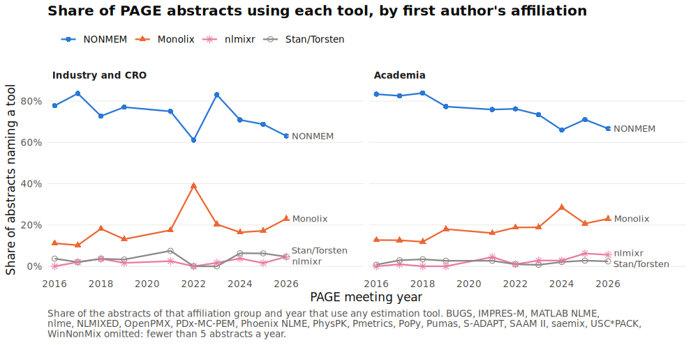

Table 7 gives the abstracts per affiliation group and year.

Table 7. PAGE abstracts by first author's affiliation

|                               | 2016| 2017| 2018| 2019| 2021| 2022| 2023| 2024| 2025| 2026|
|:------------------------------|----:|----:|----:|----:|----:|----:|----:|----:|----:|----:|
|Industry and CRO: abstracts    |  121|  118|  136|  132|   82|   83|  148|  186|  179|  168|
|Industry and CRO: using a tool |   54|   49|   55|   61|   40|   36|   59|   79|   64|   65|
|Academia: abstracts            |  196|  172|  191|  245|  191|  181|  246|  267|  271|  269|
|Academia: using a tool         |  126|  103|  118|  150|  112|  101|  143|  144|  145|  126|

**Discussion.** PAGE is a European meeting, and
60% of the first authors are academic.
An abstract shows work as of the abstract deadline in March of the meeting
year. PAGE is therefore the most current of the sources, but it is not a
sample of industry work.

The counts are the tools the authors say they used. Abstracts in PAGE's
methodology sessions that develop or test a tool count like any other. The
prediction [From methodology to applied work](#2-from-methodology-to-applied-work)
counts the methodology and applied abstracts separately.

## Analysis types by tool

*Development run results: read by Claude Code subagents (Claude Sonnet 5, 2026-09-27 to 2026-09-29); the numbers may change at the production run.*

**In short.**

- In FDA submissions, the sponsor's estimation tool is used for population
  pharmacokinetics (PK) alone for 83% of the 148
  drugs whose review names that tool. At PAGE, 46% of the
  1886 abstracts that used a tool are PK only.
- At PAGE, NONMEM carries most of the plain PK work, and the other tools lean
  towards the more complex analyses.
- Stan/Torsten leans towards full Bayesian models. This is expected, since a
  model fitted in Stan is a full Bayesian model.
- nlmixr, Pumas and Stan/Torsten have few abstracts, and most of them are in
  methodology sessions. Their leanings therefore describe methods work more
  than applied work.
- Monolix leans towards machine learning, but most of those abstracts are
  from 2024 to 2026 and in methodology sessions. An earlier Monolix lean
  towards QSP and PBPK did not survive the reading.

**Methods.**

- **Items:** every abstract of the PAGE meetings since 2016 and every PubMed
  and Europe PMC paper that names an [estimation tool](../../docs/glossary.md) is
  classified by analysis type. PAGE is the annual meeting of the Population
  Approach Group in Europe. The type is decided from the title and abstract.
- **Types:** the types run in order of complexity from PK only to
  quantitative systems pharmacology (QSP) and physiologically based
  pharmacokinetic (PBPK) models, as listed in Table 8. PK/PD stands for
  pharmacokinetic-pharmacodynamic, AI for artificial intelligence, and a
  neural ODE is a neural ordinary differential equation. Joint models are
  counted with time-to-event, as they are rare. An item can have several
  types.
- **PAGE:** the abstracts were read for their types together with the tool
  roles in an earlier reading, by Claude Sonnet 5 readers. A
  [blind check](../../docs/glossary.md) gave the same set of types for
  448 of the
  498 abstracts it compared. The tools
  are those that reading found used.
- **Literature:** keyword rules decide the types. A Claude Sonnet 5 reader
  checked a fresh sample against the type definitions and agreed with the
  rules on 215 of 231 items.
- **Tools in the literature:** for Europe PMC the tool is the one that fitted
  the final model, as read for the analysis of model and data size
  (`analysis/model_size/`). A tool named only as a comparator therefore does
  not count. In PubMed every tool named counts.
- **FDA reviews:** the keyword rules did not work on these, because a review
  mixes several analyses, tools and template sections on every page; two checks
  of the rules agreed with fewer than half of the drugs. Claude Sonnet 5
  readers read the text around each mention of the sponsor's tool instead. A check of
  the reading agreed for 21 of 22 drugs.
- **Presentation:** PubMed and the FDA reviews have few complex analyses, so
  they are shown only as PK only against any other type.

Details are in the [method card](../../analysis/analysis_types/README.md).

The chart of analysis types per source shows, for each source, the share of
the items with each type.

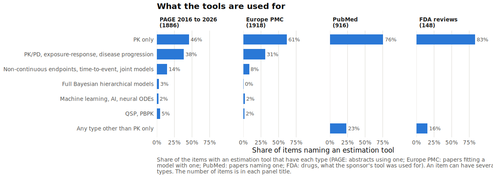

Table 8 gives the counts.

Table 8. Items with each analysis type, per source

|Type                                                  | PAGE 2016 to 2026 (1886)| Europe PMC (1918)| PubMed (916)| FDA reviews (148)|
|:-----------------------------------------------------|------------------------:|-----------------:|------------:|-----------------:|
|PK only                                               |                859 (46%)|        1179 (61%)|    693 (76%)|         123 (83%)|
|PK/PD, exposure-response, disease progression         |                720 (38%)|         591 (31%)|             |                  |
|Non-continuous endpoints, time-to-event, joint models |                272 (14%)|          161 (8%)|             |                  |
|Full Bayesian hierarchical models                     |                  59 (3%)|            7 (0%)|             |                  |
|Machine learning, AI, neural ODEs                     |                  43 (2%)|           43 (2%)|             |                  |
|QSP, PBPK                                             |                  93 (5%)|           31 (2%)|             |                  |
|Any type other than PK only                           |                         |                  |    213 (23%)|          23 (16%)|

The chart of ratios compares the tools at PAGE. For each tool and type, it
divides the tool's share of the type by the share among the abstracts that do
not use the tool. The 95% interval of each ratio is computed on the log scale
(the Katz method). A tool leans towards a type when the whole interval is above
1, and away from it when the whole interval is below 1.

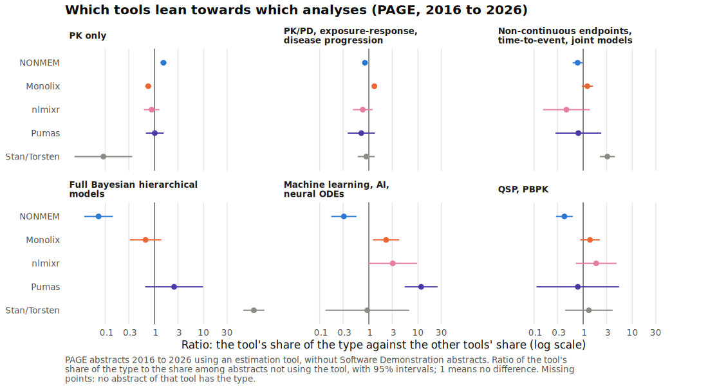

Table 9 gives the ratios, intervals and counts.

Table 9. PAGE 2016 to 2026: ratio of each tool's share of a type to the other tools' share

|Tool         |Type                                                  | Abstracts with the type|  Ratio (95% interval)|
|:------------|:-----------------------------------------------------|-----------------------:|---------------------:|
|NONMEM       |PK only                                               |             696 of 1390|      1.5 (1.3 to 1.7)|
|NONMEM       |PK/PD, exposure-response, disease progression         |             504 of 1390|      0.8 (0.7 to 0.9)|
|NONMEM       |Non-continuous endpoints, time-to-event, joint models |             186 of 1390|      0.8 (0.6 to 1.0)|
|NONMEM       |Full Bayesian hierarchical models                     |              10 of 1390|      0.1 (0.0 to 0.1)|
|NONMEM       |Machine learning, AI, neural ODEs                     |              20 of 1390|      0.3 (0.2 to 0.6)|
|NONMEM       |QSP, PBPK                                             |              50 of 1390|      0.4 (0.3 to 0.6)|
|Monolix      |PK only                                               |              130 of 363|      0.7 (0.6 to 0.9)|
|Monolix      |PK/PD, exposure-response, disease progression         |              170 of 363|      1.3 (1.1 to 1.5)|
|Monolix      |Non-continuous endpoints, time-to-event, joint models |               61 of 363|      1.2 (0.9 to 1.6)|
|Monolix      |Full Bayesian hierarchical models                     |                8 of 363|      0.7 (0.3 to 1.4)|
|Monolix      |Machine learning, AI, neural ODEs                     |               15 of 363|      2.2 (1.2 to 4.2)|
|Monolix      |QSP, PBPK                                             |               23 of 363|      1.4 (0.9 to 2.2)|
|nlmixr       |PK only                                               |                18 of 45|      0.9 (0.6 to 1.3)|
|nlmixr       |PK/PD, exposure-response, disease progression         |                13 of 45|      0.8 (0.5 to 1.2)|
|nlmixr       |Non-continuous endpoints, time-to-event, joint models |                 3 of 45|      0.5 (0.2 to 1.4)|
|nlmixr       |Full Bayesian hierarchical models                     |                 0 of 45|                      |
|nlmixr       |Machine learning, AI, neural ODEs                     |                 3 of 45|      3.1 (1.0 to 9.5)|
|nlmixr       |QSP, PBPK                                             |                 4 of 45|      1.8 (0.7 to 4.8)|
|Pumas        |PK only                                               |                12 of 26|      1.0 (0.7 to 1.5)|
|Pumas        |PK/PD, exposure-response, disease progression         |                 7 of 26|      0.7 (0.4 to 1.3)|
|Pumas        |Non-continuous endpoints, time-to-event, joint models |                 3 of 26|      0.8 (0.3 to 2.3)|
|Pumas        |Full Bayesian hierarchical models                     |                 2 of 26|      2.5 (0.6 to 9.7)|
|Pumas        |Machine learning, AI, neural ODEs                     |                 6 of 26|    11.6 (5.4 to 25.1)|
|Pumas        |QSP, PBPK                                             |                 1 of 26|      0.8 (0.1 to 5.4)|
|Stan/Torsten |PK only                                               |                 2 of 47|      0.1 (0.0 to 0.4)|
|Stan/Torsten |PK/PD, exposure-response, disease progression         |                16 of 47|      0.9 (0.6 to 1.3)|
|Stan/Torsten |Non-continuous endpoints, time-to-event, joint models |                20 of 47|      3.1 (2.2 to 4.4)|
|Stan/Torsten |Full Bayesian hierarchical models                     |                43 of 47| 105.2 (64.1 to 172.6)|
|Stan/Torsten |Machine learning, AI, neural ODEs                     |                 1 of 47|      0.9 (0.1 to 6.6)|
|Stan/Torsten |QSP, PBPK                                             |                 3 of 47|      1.3 (0.4 to 4.0)|

**Conclusions.** The first conclusion comes from Table 8, the leanings of the
tools from Table 9. A tool "leans towards no type" when none of its intervals
lies wholly above 1.

- In FDA submissions the sponsor's estimation tool is used for population PK alone for 83% of the drugs; at PAGE, 46% of the abstracts are PK only.
- **NONMEM** leans towards PK only, and away from PK/PD or exposure-response, non-continuous endpoints or time-to-event, full Bayesian models, machine learning and QSP or PBPK.
- **Monolix** leans towards PK/PD or exposure-response and machine learning, and away from PK only.
- **nlmixr** leans towards no type.
- **Pumas** leans towards machine learning.
- **Stan/Torsten** leans towards non-continuous endpoints or time-to-event and full Bayesian models, and away from PK only.

**Discussion.** nlmixr, Pumas and Stan/Torsten have few PAGE abstracts, and
most of them are in methodology sessions (the PAGE sessions on methods,
recognised from the session label). Their leanings therefore describe methods
work more than applied work. For each tool, the number of abstracts that used
it and the share of its abstracts in methodology sessions:

- NONMEM: 1390 abstracts, 17% in
  methodology sessions;
- Monolix: 363 abstracts,
  23% in methodology sessions;
- nlmixr: 45 abstracts, 58% in
  methodology sessions;
- Pumas: 26 abstracts, 81% in
  methodology sessions;
- Stan/Torsten: 47 abstracts,
  57% in methodology sessions.

The FDA figure covers only what the sponsor's estimation tool was used for.
The reviews also describe analyses done with other tools, and those are not
counted. An example is an exposure-response analysis in R next to a NONMEM
population PK model. In PubMed, every tool named counts, and a mention is not
proof of use.

Two Monolix leanings were checked abstract by abstract, by a reader asked to
test the claim. The
15 machine learning
abstracts are all Monolix-based machine learning work. Most are from 2024 to
2026 and in methodology sessions. Some are vendor tool development, or neural
ODEs implemented in several tools at once.

The earlier lean towards QSP and PBPK did not survive the reading. Of the
23 abstracts left, 8 used Monolix for another
part of the work. The PBPK model in those abstracts was built in another tool,
or in a tool not stated. They count as QSP or PBPK for Monolix because each
abstract gets its types as a whole, not per tool.

## Model and data size by tool

*Development run results: read by Claude Code subagents; the numbers may change at the production run.*

**In short.**

- The hypothesis that the SAEM method (stochastic approximation expectation
  maximisation, the Monolix default) leads to larger models holds for the
  random effects, but not for the fixed effects. Models fitted with Monolix,
  and with SAEM whatever the tool, carry more terms for inter-individual
  variability (IIV). NONMEM models carry more covariate effects before
  adjustment, but not after: the adjusted ratio for the covariate effects is
  0.96 (0.79 to 1.16).
- Monolix models have more random effects than
  NONMEM models: 4.0
  against 3.2 IIV terms on average.
  The adjusted ratio is 1.27 (1.15 to 1.41).
  For models of the pharmacokinetics alone (PK only) it is
  1.24 (1.10 to 1.38).
- Before adjustment, Monolix models have fewer fixed effects than
  NONMEM models: 7.2
  against 8.6 on average. The
  difference lies mainly in the covariate effects:
  2.1 against
  3.1.
- Adjusted for analysis type, data size and year, the fixed-effect ratio is
  0.95 (0.86 to 1.05). For PK only
  models it is 0.89 (0.79 to 0.99).
- By estimation method, SAEM models have more random effects than
  models fitted by first-order conditional estimation
  (FOCE), with an adjusted ratio of
  1.36 (1.22 to 1.51). They
  have about as many fixed effects as
  FOCE models, with a ratio of
  1.00 (0.90 to 1.10).

**Methods.** The hypothesis is that SAEM, the Monolix default, is more
permissive than NONMEM's gradient-based methods, and so leads to larger
models. The terms used here:

- **Fixed effects:** the structural fixed effects plus the covariate effects
  of the final model. Residual error parameters are not counted.
- **Random effects:** the inter-individual variability (IIV) terms of the
  final model.
- **IOV:** inter-occasion variability.
- **SAEM:** stochastic approximation expectation maximisation, the default
  estimation method of Monolix.
- **FOCE:** first-order conditional estimation, a gradient-based method of
  NONMEM.
- **PK only:** a model of the pharmacokinetics (PK) alone.

The papers are those of the Europe PMC [core set](../../docs/glossary.md) from 2021
to 2026 that name an estimation tool: 2379 papers. Claude Sonnet 5
read each paper and recorded:

- whether the authors fitted a population model of their own;
- the fitting tool, the estimation method and the analysis type;
- from the final parameter table, the number of structural fixed effects,
  covariate effects, IIV terms, IOV terms, random-effect covariances and
  residual error parameters;
- the number of subjects and of observations in the data.

A blind check by Claude Opus 5.5 read a random 403 of the
2379 papers again. The two readers agreed on the tool for
302 of 307 papers. They agreed on
the fixed effects for 188 of
203 papers, and on the random effects for
186 of 199.
Their counts showed no systematic difference.

The tool comparison uses the papers with a single final model, since several
models added together would read as one large model. Of these,
815 NONMEM papers and
156 Monolix papers give a count
of their fixed effects. Not every paper gives every part of the model, so the
number of papers differs a little from part to part; Table 10 gives it for
each. The ratio of the Monolix mean to the NONMEM mean comes from a
quasi-Poisson regression of the count on the tool. It is given crude, and
adjusted for analysis type, data size (the log number of subjects) and
publication year. The same regression compares SAEM with FOCE, whatever the
tool. Details: [method card](../../analysis/model_size/README.md).

The model-size chart shows the distribution of fixed and random effects in the
final models, with the mean and its 95% interval, for all models and for PK
only models.

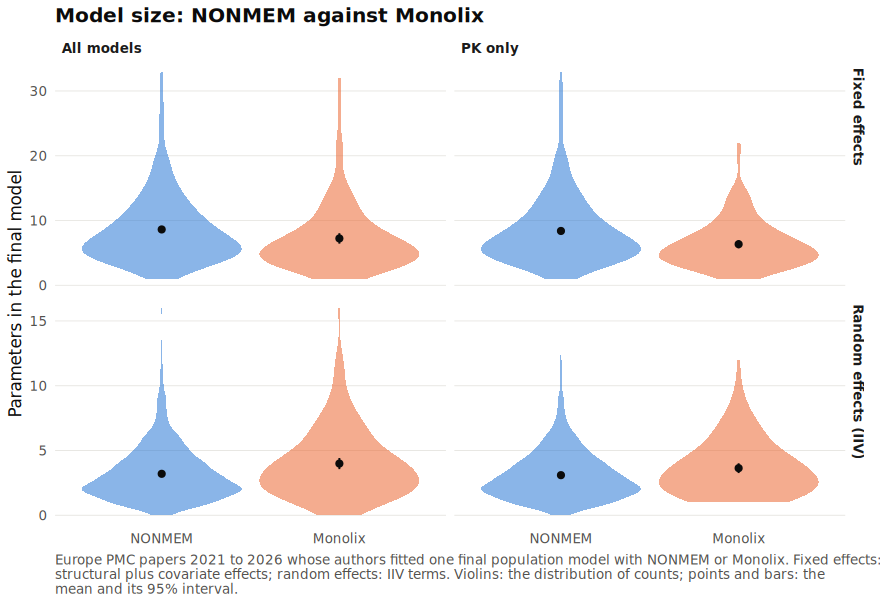

Table 10 gives the mean of every part of the final model, per tool.

Table 10. Mean number of parameters in the final model (95% interval, papers)

|Parameters                             |             NONMEM, all|            Monolix, all|         NONMEM, PK only|        Monolix, PK only|
|:--------------------------------------|-----------------------:|-----------------------:|-----------------------:|-----------------------:|
|Fixed effects (structural + covariate) | 8.6 (8.3 to 9.0), n=815| 7.2 (6.4 to 8.0), n=156| 8.4 (8.0 to 8.8), n=725| 6.3 (5.7 to 7.0), n=129|
|Random effects (IIV)                   | 3.2 (3.1 to 3.3), n=806| 4.0 (3.6 to 4.4), n=150| 3.1 (3.0 to 3.2), n=720| 3.6 (3.3 to 4.0), n=125|
|Structural fixed effects               | 5.5 (5.3 to 5.7), n=830| 5.1 (4.6 to 5.7), n=160| 5.2 (5.0 to 5.5), n=740| 4.6 (4.1 to 5.0), n=133|
|Covariate effects                      | 3.1 (2.9 to 3.4), n=815| 2.1 (1.7 to 2.5), n=156| 3.2 (2.9 to 3.4), n=725| 1.8 (1.4 to 2.1), n=129|
|IOV terms                              | 0.3 (0.2 to 0.3), n=805| 0.3 (0.1 to 0.4), n=155| 0.3 (0.2 to 0.3), n=717| 0.3 (0.2 to 0.5), n=128|
|Random-effect covariances              | 0.5 (0.3 to 0.6), n=801| 0.2 (0.1 to 0.4), n=155| 0.4 (0.3 to 0.6), n=715| 0.1 (0.1 to 0.2), n=128|
|Residual error parameters              | 1.8 (1.7 to 1.9), n=794| 1.6 (1.5 to 1.8), n=143| 1.8 (1.7 to 1.9), n=710| 1.5 (1.4 to 1.6), n=119|

Table 11 gives the ratio of Monolix to NONMEM means, crude and adjusted, and
the same ratio for SAEM against FOCE whatever the tool.

Table 11. Ratio of mean parameter counts, crude and adjusted for analysis type, data size and year

|Comparison                               |Parameters                             | Crude ratio (95% interval)| Adjusted ratio (95% interval)| Papers (adjusted)|
|:----------------------------------------|:--------------------------------------|--------------------------:|-----------------------------:|-----------------:|
|Monolix against NONMEM, all models       |Fixed effects (structural + covariate) |        0.84 (0.75 to 0.94)|           0.95 (0.86 to 1.05)|               940|
|Monolix against NONMEM, all models       |Random effects (IIV)                   |        1.25 (1.12 to 1.39)|           1.27 (1.15 to 1.41)|               925|
|Monolix against NONMEM, all models       |Structural fixed effects               |        0.93 (0.83 to 1.03)|           0.94 (0.85 to 1.05)|               957|
|Monolix against NONMEM, all models       |Covariate effects                      |        0.67 (0.53 to 0.84)|           0.96 (0.79 to 1.16)|               940|
|Monolix against NONMEM, PK only          |Fixed effects (structural + covariate) |        0.76 (0.67 to 0.86)|           0.89 (0.79 to 0.99)|               832|
|Monolix against NONMEM, PK only          |Random effects (IIV)                   |        1.17 (1.05 to 1.31)|           1.24 (1.10 to 1.38)|               823|
|Monolix against NONMEM, PK only          |Structural fixed effects               |        0.87 (0.77 to 0.97)|           0.90 (0.80 to 1.01)|               849|
|Monolix against NONMEM, PK only          |Covariate effects                      |        0.56 (0.43 to 0.73)|           0.83 (0.67 to 1.04)|               832|
|SAEM against FOCE (any tool), all models |Fixed effects (structural + covariate) |        1.01 (0.90 to 1.13)|           1.00 (0.90 to 1.10)|               571|
|SAEM against FOCE (any tool), all models |Random effects (IIV)                   |        1.45 (1.30 to 1.62)|           1.36 (1.22 to 1.51)|               564|
|SAEM against FOCE (any tool), all models |Structural fixed effects               |        1.13 (1.02 to 1.25)|           1.06 (0.96 to 1.17)|               578|
|SAEM against FOCE (any tool), all models |Covariate effects                      |        0.80 (0.64 to 1.00)|           0.88 (0.72 to 1.07)|               571|

The data-size chart shows the number of subjects and of observations in the
dataset of the final model, per tool.

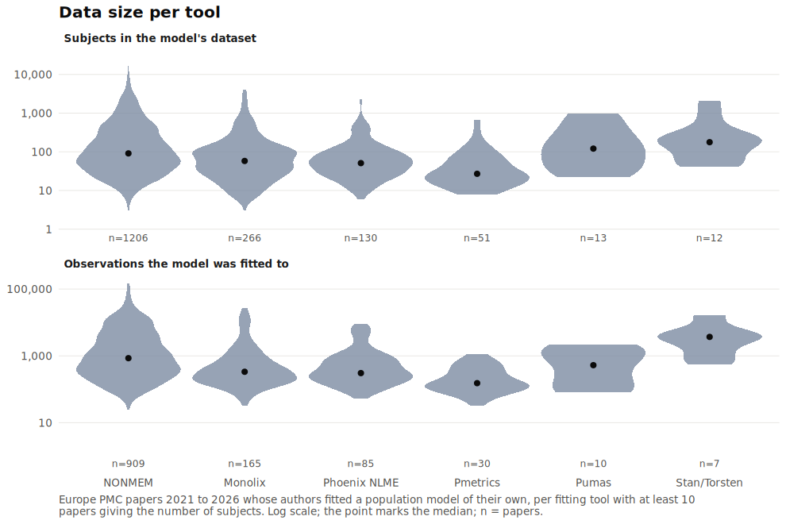

Table 12 gives the medians and quartiles of the data size, per tool.

Table 12. Data size per tool: median (quartiles) and papers

|Tool         | Papers, own fit|        Subjects| Papers giving subjects|           Observations| Papers giving observations|
|:------------|---------------:|---------------:|----------------------:|----------------------:|--------------------------:|
|NONMEM       |            1357|  91 (39 to 290)|                   1206|     855 (297 to 3,418)|                        909|
|Monolix      |             297|  58 (27 to 121)|                    266|       335 (174 to 779)|                        165|
|Phoenix NLME |             140|   51 (29 to 94)|                    130|       306 (196 to 848)|                         85|
|Pmetrics     |              57|   27 (16 to 61)|                     51|       153 (105 to 345)|                         30|
|Pumas        |              17| 121 (36 to 278)|                     13|     582 (141 to 1,278)|                         10|
|Stan/Torsten |              15| 178 (85 to 270)|                     12| 3,704 (1,697 to 4,545)|                          7|

**Conclusions**

- The median dataset has 91 subjects for NONMEM, 58 subjects for Monolix, 51 subjects for Phoenix NLME, 27 subjects for Pmetrics, 121 subjects for Pumas and 178 subjects for Stan/Torsten.

**Discussion.** Most of the fixed-effect difference between the tools goes
with data size and analysis type. The adjusted ratio is close to 1
overall, although PK only models keep a small difference, 0.89 (0.79 to 0.99).

SAEM models are mostly Monolix models: 169
of 190. The comparison by estimation method
therefore adds little to the comparison by tool. The papers cannot tell
whether the extra random effects come from the estimation method or from how
models are usually built in each tool.

The NONMEM papers state the estimation method in 555 of
1357 cases. The counts come only from papers that
show the final estimates in the article text.

Counting all final models of a paper together gives an adjusted ratio of
0.94 (0.85 to 1.04) for the fixed effects. For the random effects it
is 1.26 (1.15 to 1.39).

The data are observational: tool, data and purpose come together. The
adjustment removes only what analysis type, data size and year explain.

## Predictions

*Development run results: read by Claude Code subagents; the numbers may change at the production run.*

Two ways of reading ahead from the data: how far regulatory submissions trail
what industry shows at PAGE, and how methodology work at PAGE turns into
applied work some years later.

### 1. The lag of FDA submissions behind PAGE

**In short.**

- NONMEM's share of the PAGE abstracts from industry and contract research
  organisations (CROs) follows a trend from 80% in 2016 to
  67% in 2026.
- NONMEM's share of the FDA approvals of 2021 to 2025 is 93%.
  That is 155 of the 167 drugs with an
  identifiable tool.
- Extended back in time, the PAGE trend reaches NONMEM's FDA share only around
  1998. That year lies before the PAGE data begin, so it says
  only that the FDA series trails PAGE by more than a decade.
- Lags of 13 to 15 years fit about as well
  (relative likelihood above 0.15), and the best fit is at 15 years, the longest lag the PAGE years allow. The lag is therefore a lower bound, not an estimate.

**Methods.** The idea is that PAGE shows what industry does now, while FDA
reviews show analyses done years earlier. If so, the FDA share of a tool in approval year t should
equal the PAGE share in year t minus some lag. The PAGE share is taken among
the abstracts that used a tool and whose first author works in industry or at
a CRO. The FDA share is taken among the drugs with an identifiable tool: those
whose review states, directly or indirectly, the tool the applicant used.

The test uses NONMEM, the only tool with enough FDA counts. A logistic trend
in year is fitted to NONMEM's PAGE share from 2006 to
2026. Each lag from 0 to 15 years is then
scored by its binomial likelihood. This is the probability of the yearly FDA
counts if the FDA share in each year were the PAGE trend that many years
earlier. The relative likelihood of a lag is its likelihood divided by that of
the best-fitting lag, so the best lag has a relative likelihood of 1. A lag
with a relative likelihood near 0 fits the FDA counts far worse than the best
lag.

The lag chart shows how well each lag fits the FDA counts, relative to the
best-fitting lag.

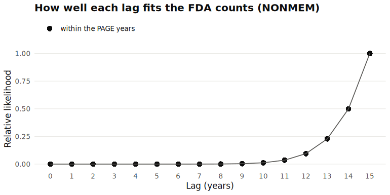

Table 13 gives the relative likelihood of each lag.

Table 13. Relative likelihood of each lag

| Lag (years)| Relative likelihood|
|-----------:|-------------------:|
|           0|                0.00|
|           1|                0.00|
|           2|                0.00|
|           3|                0.00|
|           4|                0.00|
|           5|                0.00|
|           6|                0.00|
|           7|                0.00|
|           8|                0.00|
|           9|                0.00|
|          10|                0.01|
|          11|                0.04|
|          12|                0.09|
|          13|                0.23|
|          14|                0.50|
|          15|                1.00|

The projection chart shows the yearly NONMEM shares at PAGE and at FDA, the
PAGE trend, and the FDA share projected from the trend at the best-fitting
lag.

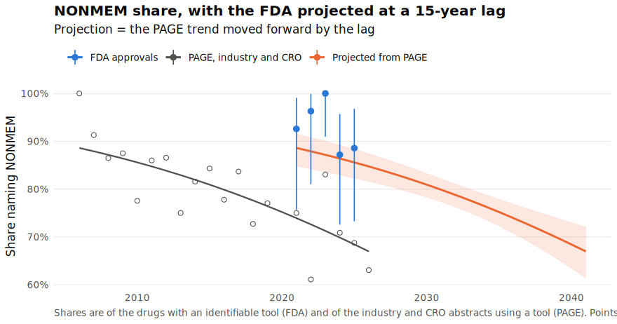

Table 14 gives the yearly NONMEM shares at PAGE and at FDA.

Table 14. NONMEM share per year, PAGE industry and CRO abstracts and FDA approvals

|Year | PAGE, industry and CRO: NONMEM among abstracts using a tool| FDA approvals: NONMEM among drugs with an identifiable tool|
|:----|-----------------------------------------------------------:|-----------------------------------------------------------:|
|2006 |                                             14 of 14 (100%)|                                                            |
|2007 |                                              42 of 46 (91%)|                                                            |
|2008 |                                              32 of 37 (86%)|                                                            |
|2009 |                                              35 of 40 (88%)|                                                            |
|2010 |                                              38 of 49 (78%)|                                                            |
|2011 |                                              43 of 50 (86%)|                                                            |
|2012 |                                              58 of 67 (87%)|                                                            |
|2013 |                                              39 of 52 (75%)|                                                            |
|2014 |                                              31 of 38 (82%)|                                                            |
|2015 |                                              43 of 51 (84%)|                                                            |
|2016 |                                              42 of 54 (78%)|                                                            |
|2017 |                                              41 of 49 (84%)|                                                            |
|2018 |                                              40 of 55 (73%)|                                                            |
|2019 |                                              47 of 61 (77%)|                                                            |
|2021 |                                              30 of 40 (75%)|                                              25 of 27 (93%)|
|2022 |                                              22 of 36 (61%)|                                              26 of 27 (96%)|
|2023 |                                              49 of 59 (83%)|                                             39 of 39 (100%)|
|2024 |                                              56 of 79 (71%)|                                              34 of 39 (87%)|
|2025 |                                              44 of 64 (69%)|                                              31 of 35 (89%)|
|2026 |                                              41 of 65 (63%)|                                                            |

**Conclusions**

- Since 15 years is only a lower bound on the lag, the projected shares show what the PAGE trend gives at that lag, not a forecast. At
  the best-fitting lag, the projected NONMEM share of FDA approvals is
  81% in 2030 (95% interval 78%
  to 83%). In 2041 it is
  67% (95% interval 61% to
  72%). The intervals cover only the uncertainty of
  the PAGE trend at that lag, not the uncertainty of the lag itself.

**Discussion.** A lag that long is more than the 1 to 3 years between an
analysis and approval. It would mean one of two things. The tools used in
submissions may change far more slowly than the tools shown at PAGE. Or
submissions may differ from PAGE work in level, which this model cannot tell
apart from a delay: it assumes that the FDA share equals the lagged PAGE share
with no other difference. The analysis is exploratory, and a shorter lag
within the plausible range would bring the projected decline forward.

### 2. From methodology to applied work

**In short.**

- Monolix and BUGS started in methodology sessions and moved into applied
  work within a few years. BUGS has since disappeared from PAGE.
- nlmixr's applied abstracts have grown since 2023, although methodology
  sessions still hold most of them.
- Pumas, and machine learning as a kind of analysis, are still mostly in
  methodology sessions, as Monolix was around 2008.
- Stan/Torsten shows no such shift: it has stayed about evenly split since it
  first appeared.

**Methods.** New tools and new kinds of analysis tend to appear first in
PAGE's methodology sessions, and a few years later in applied work. If so, a
tool that is mostly seen in methodology sessions today is a candidate for
wider applied use tomorrow.

Each PAGE abstract that used a tool is counted as methodology or applied work
by its session. PAGE has titled its methodology sessions with a "Methodology"
prefix since 2014. In 2011 to 2013 it titled them by topic alone, for example
"Estimation methods" or "Model evaluation", so those topics are recognised as
methodology too. Sessions on physiologically based pharmacokinetic (PBPK)
models count as applied work throughout. Machine learning is counted in the
same way, as a kind of analysis in any tool: machine learning, artificial
intelligence (AI) or neural ordinary differential equations (neural ODEs).

The chart counts, for each meeting year, the abstracts using each tool in
methodology and in applied sessions.

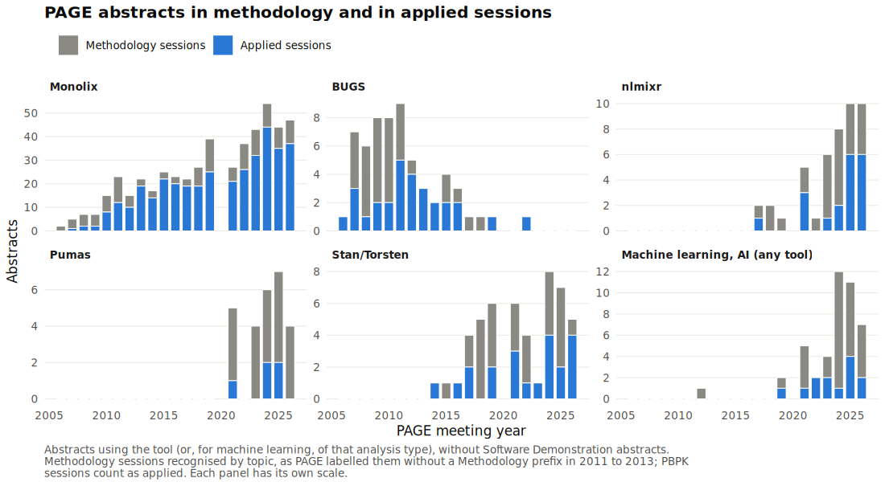

Table 15 gives each tool's share of abstracts in methodology sessions at two
times. The first is the first four meeting years with at least one abstract
using the tool; the second is 2023 to 2026.

Table 15. Share of each tool's PAGE abstracts in methodology sessions

|Tool or type                    |First four meeting years | Abstracts, first four years| In methodology sessions, first four years| Abstracts, 2023 to 2026| In methodology sessions, 2023 to 2026|
|:-------------------------------|:------------------------|---------------------------:|-----------------------------------------:|-----------------------:|-------------------------------------:|
|Monolix                         |2006 to 2009             |                          21|                                       76%|                     188|                                   21%|
|BUGS                            |2006 to 2009             |                          22|                                       68%|                       0|                                      |
|nlmixr                          |2017 to 2021             |                          10|                                       60%|                      34|                                   56%|
|Pumas                           |2021 to 2025             |                          22|                                       77%|                      21|                                   81%|
|Stan/Torsten                    |2014 to 2017             |                           7|                                       43%|                      21|                                   48%|
|Machine learning, AI (any tool) |2012 to 2022             |                          10|                                       60%|                      34|                                   74%|

**Discussion.** If the pattern holds, the applied use of Pumas and of machine
learning should grow over the next few years. But the counts are small, often
under ten abstracts a year. The pattern rests on two tools that have completed the
move and one that is making it. It is suggestive, not a
fitted model. Methodology abstracts about a tool itself are counted like any
other.

## AI and machine learning

*Development run results: read by Claude Code subagents; the numbers may change at the production run.*

**In short.**

- Machine learning reached pharmacometrics as neural networks. It was first
  used at PAGE in 1996, in a neural network that predicted the
  pharmacokinetics (PK) and pharmacodynamics (PD) of carboplatin and melphalan
  and was compared with NONMEM. It was first used in PubMed in
  1997. Until 2015 it appeared in at most 3
  abstracts or papers a year in any source.
- The current wave starts in the late 2010s at PAGE. Random forests were
  first used there in 2017. Gradient boosting
  followed in 2019, and neural ordinary
  differential equations (neural ODEs) in 2021.
- A second wave follows with large language models and AI agents. Large
  language models were first used in PubMed in
  2023 and at PAGE in
  2024. AI agents were first used at PAGE in
  2025 and in PubMed in 2026.
- Machine learning is mostly used where it is named. It was used in
  163 of the 238 PubMed
  papers that name it. It was used in 189 of the
  235 PAGE abstracts that name it. AI is more often a
  word in the background: it was used in 25 of
  the 86 PubMed papers that name it.
- No FDA review of the 2021 to 2025 approvals describes a pharmacometric
  analysis with machine learning or AI.

**Methods.** Two groups of terms are searched in every source
([term list](../../taxonomy/ai_ml_terms.csv)):

- **Machine learning:** the named learning methods, which are
  machine learning, neural networks, deep learning, neural ODEs, random forests, gradient boosting, support vector machines, reinforcement learning, symbolic regression and k-nearest neighbours.
- **AI:** the label and its newer forms, which are
  artificial intelligence, AI, expert systems, large language models, ChatGPT and GPT, generative AI and AI agents.

Each source is counted against its own base set, the items of the source in a
year. The sources, and the text searched in each, are:

- **PAGE** (the annual meeting of the Population Approach Group in Europe):
  every abstract of the meetings 1992 to 2026, title and body. That is
  6900 abstracts. The 764 abstracts from before 2006 were
  fetched for this analysis only.
- **PubMed:** every paper found by the search terms of the
  [core set](../../docs/glossary.md), from the first such paper in
  1971. The title and abstract are
  searched.
- **Europe PMC:** every paper with open-access full text found by the same
  search terms. The title, abstract, keywords and body are searched, but not
  the reference list or the declarations.
- **FDA:** the reviews of the drugs approved in 2021 to 2025.

In all, 988 items name at least one term. In a
[reading](../../docs/glossary.md), Claude Sonnet 5.5 decided for each item and each
term it names whether the term was:

- **Used:** the authors apply or develop the method.
- **Mentioned:** the term appears as background, in a citation, in a review or
  in a proposal.
- **Not the method:** the letters mean something else, such as AI for
  aromatase inhibitor, autoinjector or accumulation index, or the term is only
  in a reference list entry or the name of a funding programme.

The AI label counts as used only when the authors call their own method or
tool AI.

A [blind check](../../docs/glossary.md) by Claude Opus 5.5 read a random
148 of the items again. Together they hold 315 item
and term pairs. The two readers gave the same decision
for 299 of the 315 pairs. They agreed on whether the
term counts at all (used or mentioned, against not the method) for
309 of the 315 pairs. Claude Opus 5.5 decided the
disagreements. Every item on which a first year in Table 16 or Table 17 rests
was read again in full. Details: [method card](../../analysis/ai_ml/README.md).

The chart of shares per year shows, for each source and year, the share of the
base set that mentions or uses each group.

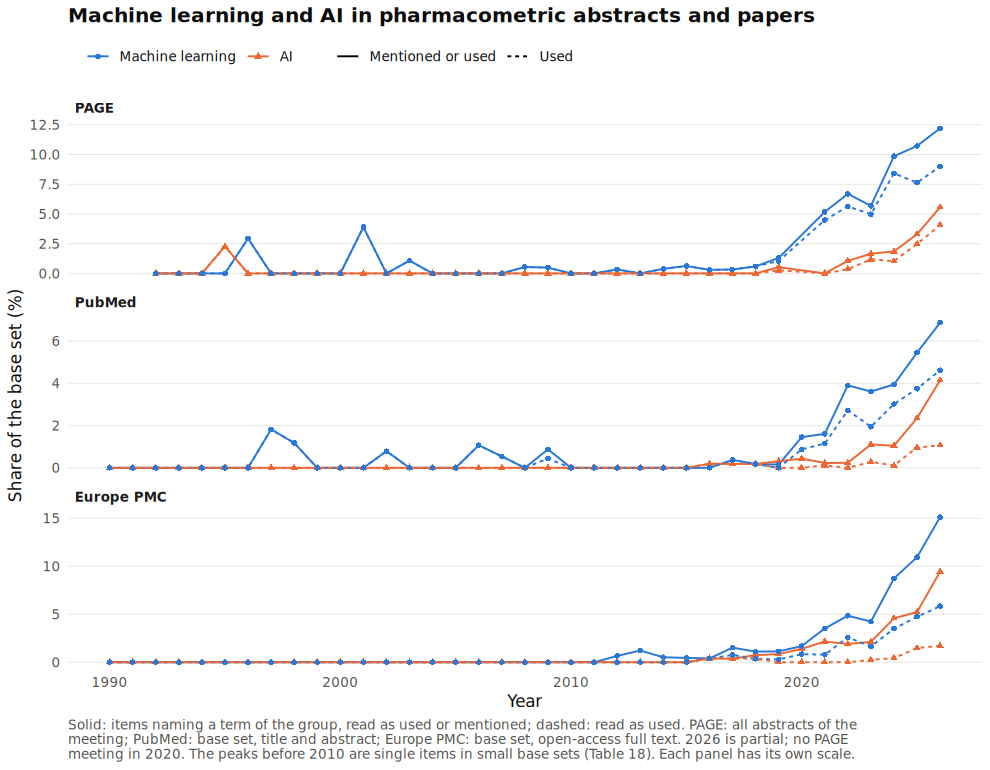

The chart of use in the last ten years narrows this to use alone, with the
three sources together.

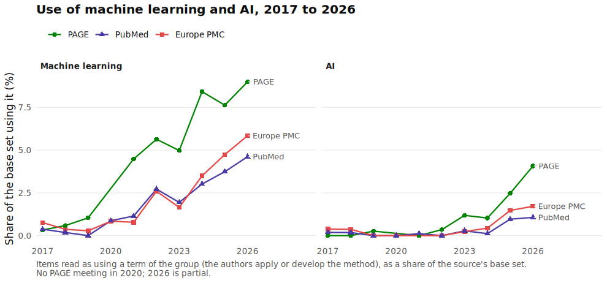

Table 16 gives the first mention and the first use per source. Table 17 gives
the first year per term. Table 18 gives the counts per year; PAGE held no
meeting in 2020, so its cells for that year are empty.

Table 16. First mention and first use of machine learning and AI, per source

|Source     |Group            | First mentioned|Item              |First used |Item used         |What it was (first use)                                                        |
|:----------|:----------------|---------------:|:-----------------|:----------|:-----------------|:------------------------------------------------------------------------------|
|PAGE       |Machine learning |            1996|[PAGE abstract 582](https://www.page-meeting.org/Abstracts/neural-network-prediction-of-dose-and-pp-parameters-values-from-a-population-approach-point-of-view-some-examples-and-comments/)|1996       |[PAGE abstract 582](https://www.page-meeting.org/Abstracts/neural-network-prediction-of-dose-and-pp-parameters-values-from-a-population-approach-point-of-view-some-examples-and-comments/)|neural network predicting dose and PK/PD values                                |
|PAGE       |AI               |            1995|[PAGE abstract 646](https://www.page-meeting.org/Abstracts/software-product-popkan-population-pharmacokinetic-modelling-and-analysis/)|1995       |[PAGE abstract 646](https://www.page-meeting.org/Abstracts/software-product-popkan-population-pharmacokinetic-modelling-and-analysis/)|the developers present their population PK software POPKAN as an expert system |
|PubMed     |Machine learning |            1997|[PMID 9232526](https://pubmed.ncbi.nlm.nih.gov/9232526/)|1997       |[PMID 9232526](https://pubmed.ncbi.nlm.nih.gov/9232526/)|neural network applied to popPK data                                           |
|PubMed     |AI               |            2016|[PMID 27528266](https://pubmed.ncbi.nlm.nih.gov/27528266/)|2016       |[PMID 27528266](https://pubmed.ncbi.nlm.nih.gov/27528266/)|MARS described as AI method for covariate identification                       |
|Europe PMC |Machine learning |            2012|[PMID 23835796](https://europepmc.org/article/MED/23835796)|2016       |[PMID 27528266](https://europepmc.org/article/MED/27528266)|MARS machine learning applied to children's isoniazid data                     |
|Europe PMC |AI               |            2016|[PMID 27528266](https://europepmc.org/article/MED/27528266)|2016       |[PMID 27528266](https://europepmc.org/article/MED/27528266)|MARS called AI by the authors, used to find predictors of NAT2 kinetics        |
|FDA        |Machine learning |            2025|[NDA/BLA 220152](https://www.accessdata.fda.gov/drugsatfda_docs/nda/2026/220152Orig1s000IntegratedR.pdf)|2025       |[NDA/BLA 220152](https://www.accessdata.fda.gov/drugsatfda_docs/nda/2026/220152Orig1s000IntegratedR.pdf)|sponsor used LLM-assisted workflow for in silico metabolite toxicity analysis  |
|FDA        |AI               |            2024|[NDA/BLA 213972](https://www.accessdata.fda.gov/drugsatfda_docs/nda/2024/213972Orig1s000IntegratedR.pdf)|2025       |[NDA/BLA 220152](https://www.accessdata.fda.gov/drugsatfda_docs/nda/2026/220152Orig1s000IntegratedR.pdf)|sponsor used LLM-assisted workflow for in silico metabolite toxicity analysis  |

Table 17. First year each term was used, and in brackets first mentioned where earlier

|Term                    |Group            |        PAGE|      PubMed|  Europe PMC|
|:-----------------------|:----------------|-----------:|-----------:|-----------:|
|neural networks         |Machine learning |        1996|        1997| 2018 (2012)|
|machine learning        |Machine learning |        2003|        2006| 2016 (2014)|
|support vector machines |Machine learning |        2014|        2009| 2022 (2018)|
|random forests          |Machine learning |        2017|        2020|        2020|
|deep learning           |Machine learning |        2019| 2023 (2021)| 2020 (2017)|
|gradient boosting       |Machine learning |        2019|        2022| 2021 (2020)|
|neural ODEs             |Machine learning |        2021|        2023| 2024 (2022)|
|reinforcement learning  |Machine learning | 2022 (2019)|        2022| 2023 (2017)|
|k-nearest neighbours    |Machine learning |        2022|        2026| 2022 (2020)|
|symbolic regression     |Machine learning |        2024|        2023| 2024 (2022)|
|expert systems          |AI               |        1995|        2018|        2018|
|artificial intelligence |AI               |        2019|        2016|        2016|
|AI                      |AI               |        2019| 2023 (2021)|            |
|large language models   |AI               | 2024 (2023)|        2023| 2025 (2024)|
|ChatGPT and GPT         |AI               |        2024|        2023|        2025|
|generative AI           |AI               |        2024|        2025| 2025 (2024)|
|AI agents               |AI               |        2025|        2026| 2026 (2025)|

Table 18. Items mentioning machine learning (ML) and AI per year, with the number using it in brackets

|Year | PAGE abstracts| PAGE: ML| PAGE: AI| PubMed papers| PubMed: ML| PubMed: AI| Europe PMC papers| Europe PMC: ML| Europe PMC: AI|
|:----|--------------:|--------:|--------:|-------------:|----------:|----------:|-----------------:|--------------:|--------------:|
|1995 |             44|        0|    1 (1)|            49|          0|          0|                 6|              0|              0|
|1996 |             34|    1 (1)|        0|            65|          0|          0|                11|              0|              0|
|1997 |             41|        0|        0|            55|      1 (1)|          0|                 6|              0|              0|
|1998 |             40|        0|        0|            85|      1 (1)|          0|                15|              0|              0|
|1999 |             46|        0|        0|            88|          0|          0|                13|              0|              0|
|2000 |             50|        0|        0|            84|          0|          0|                17|              0|              0|
|2001 |             77|    3 (3)|        0|           129|          0|          0|                15|              0|              0|
|2002 |             65|        0|        0|           127|      1 (1)|          0|                14|              0|              0|
|2003 |             93|    1 (1)|        0|           123|          0|          0|                25|              0|              0|
|2004 |             80|        0|        0|           145|          0|          0|                33|              0|              0|
|2005 |            126|        0|        0|           183|          0|          0|                39|              0|              0|
|2006 |            122|        0|        0|           187|      2 (2)|          0|                39|              0|              0|
|2007 |            142|        0|        0|           185|      1 (1)|          0|                54|              0|              0|
|2008 |            184|    1 (1)|        0|           222|          0|          0|                54|              0|              0|
|2009 |            207|    1 (1)|        0|           228|      2 (1)|          0|                71|              0|              0|
|2010 |            242|        0|        0|           282|          0|          0|                69|              0|              0|
|2011 |            287|        0|        0|           289|          0|          0|               100|              0|              0|
|2012 |            300|    1 (1)|        0|           348|          0|          0|               152|          1 (0)|              0|
|2013 |            278|        0|        0|           389|          0|          0|               164|          2 (0)|              0|
|2014 |            258|    1 (1)|        0|           445|          0|          0|               193|          1 (0)|              0|
|2015 |            319|    2 (2)|        0|           456|          0|          0|               220|          1 (0)|              0|
|2016 |            334|    1 (1)|        0|           517|          0|      1 (1)|               256|          1 (1)|          1 (1)|
|2017 |            304|    1 (1)|        0|           536|      2 (2)|      1 (1)|               263|          4 (2)|          1 (1)|
|2018 |            340|    2 (2)|        0|           550|      1 (1)|      1 (1)|               271|          3 (1)|          2 (1)|
|2019 |            384|    5 (4)|    2 (1)|           643|      1 (0)|      2 (0)|               353|          4 (1)|          3 (0)|
|2020 |               |         |         |           689|     10 (6)|      3 (0)|               356|          6 (3)|          5 (0)|
|2021 |            290|  15 (13)|        0|           871|    14 (10)|      2 (1)|               511|         18 (4)|         11 (0)|
|2022 |            284|  19 (16)|    3 (1)|           846|    33 (23)|      2 (0)|               578|        28 (15)|         11 (0)|
|2023 |            422|  24 (21)|    7 (5)|           721|    26 (14)|      8 (2)|               425|         18 (7)|          9 (1)|
|2024 |            487|  48 (41)|    9 (5)|           862|    34 (26)|      9 (1)|               458|        40 (16)|         21 (2)|
|2025 |            485|  52 (37)|  16 (12)|           936|    51 (35)|     22 (9)|               612|        67 (29)|         32 (9)|
|2026 |            467|  57 (42)|  26 (19)|           845|    58 (39)|     35 (9)|               582|        88 (34)|        55 (10)|

**Conclusions**

- The AI label came first, at PAGE in 1995, but only as a
  label. POPKAN, a Bayesian population PK program, was presented as "an expert
  system".
- "Artificial intelligence" for a method of the authors' own appears in PubMed
  in 2016, for a regression spline
  method the authors call AI. At PAGE it appears in
  2019, for a deep learning framework.
- In 2024 to 2026, 11% of PAGE abstracts
  mention machine learning, against
  0.7% in 2016 to 2019.
- In 2024 to 2026, 4% of PAGE abstracts
  mention AI, against 0.1% in 2016 to
  2019.
- In the Europe PMC full text of 2024 to 2026,
  12% of the papers mention machine
  learning.
- The only use of either group in the FDA reviews is nonclinical. For Nereus
  (2025) the applicant compared metabolite toxicity in silico with a workflow
  built on a large language model, and the reviewers questioned it.

**Discussion.** These are mentions and uses in what is published, and
publication lags the work. They also come from pharmacometric publications
only. A machine learning paper on drug concentrations that does not use the
core set's search terms is not in the PubMed or Europe PMC base set, so the
literature series understate the wider field.

Europe PMC's open-access full text is thin before about 2010, so its first
years are late by construction. PAGE, with every abstract since 1992, gives
the best dating. Europe PMC also counts a term anywhere in the text, the
introduction included, which is why its mention shares are the highest.

The analysis-type counts in Table 8 and in the machine learning row of
Table 15 measure something narrower. They count machine learning as the type
of the analysis, in items with an estimation tool.

Europe PMC's own search also reaches reference lists and declarations.
58 Europe PMC records that it returned name no term in the text
searched here, and they are not counted. Most of them have the term only in
the reference list or in a statement about the use of generative AI.

